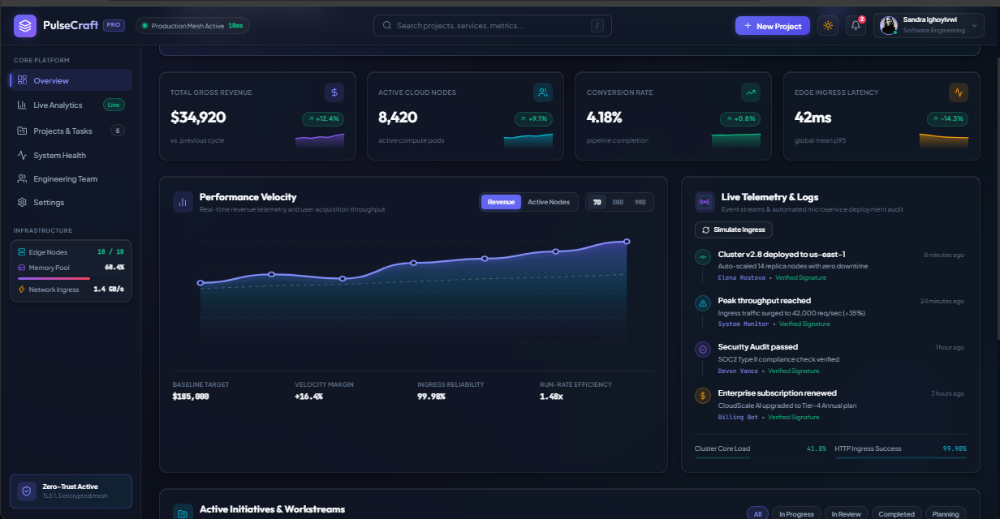
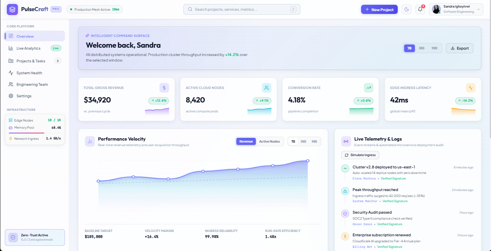
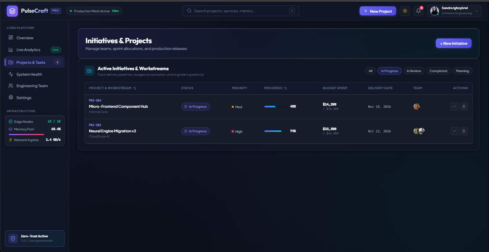
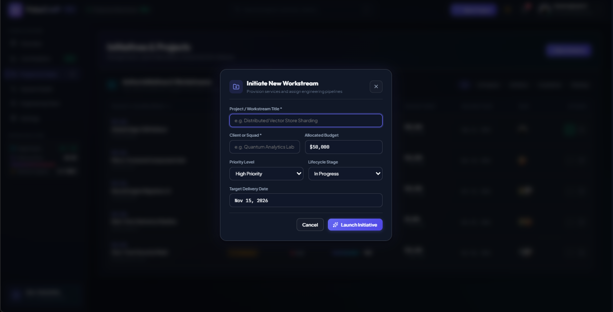
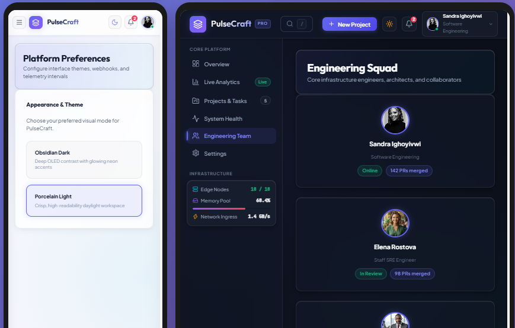

# ⚡ PulseCraft — Intelligent Analytics & Command Center


A sleek, modern Single Page Application (SPA) dashboard built with **React 19**, **Vite**, and a bespoke **Vanilla CSS design system**. PulseCraft combines real-time data visualization, telemetry monitoring, and interactive initiative tracking into an intuitive, glassmorphic command center.

---

## 📸 Screenshots & Showcase

### 1. 🌌 Primary Command Center (Obsidian Dark Mode)
Comprehensive high-level view featuring real-time telemetry metrics, dynamic performance charts, live log stream, and infrastructure load cards.



---

### 2. ☀️ Daylight Surface (Porcelain Light Mode)
Seamless theme switching with daylight-optimized contrast, crisp typography, and persistent preferences across sessions.



---

### 3. 📋 Initiatives & Workstream Management
Interactive project tracker with stage filtering (All, In Progress, In Review, Completed, Planning), progress indicators, budget tracking, and direct status toggles.



---

### 4. 🚀 Workstream Creation Flow
Sleek modal dialogue with backdrop blur for launching new engineering pipelines with budget, squad assignment, and target delivery dates.



---

### 5. 📱 Mobile Responsiveness & Team Directory
Fully adaptive drawer navigation, compact mobile preferences, and detailed engineering squad profiles with status indicators.



---

## ✨ Key Features

- **🌓 Dual Theme Engine (`Obsidian Dark` & `Porcelain Light`)**
  - Smooth transitions across all components, charts, and surfaces.
  - Automatically persists user theme selection in `localStorage`.
- **📈 Interactive SVG Data Visualizations**
  - Custom bezier curve area chart with gradient fills and active datapoint tooltips.
  - Instant time-horizon filtering (`24h`, `7d`, `30d`, `90d`) and metric switching (`Revenue` vs `Active Nodes`).
- **🗂️ Initiative & Workstream Tracker**
  - Instant search and status filtering.
  - Real-time progress bars, budget tracking, and team member badges.
  - One-click completion toggling and initiative archiving with feedback toasts.
- **🔔 Live Notifications & Telemetry Activity Feed**
  - Real-time event log with interactive ingress simulations.
  - Interactive notification drawer with unread counters, mark-as-read, and item dismissal.
- **💻 Infrastructure Telemetry Monitoring**
  - Live resource tracking for edge nodes, memory pool utilization, and network throughput.
- **📱 Fluid Responsive Architecture**
  - Desktop multi-column grid down to mobile drawer overlay navigation.
  - Zero heavy CSS framework dependencies — lightweight, tailored CSS custom properties.

---

## 🛠️ Tech Stack

| Technology | Purpose |
| :--- | :--- |
| **React 19** | Core UI component hierarchy, declarative state management & hooks |
| **Vite 8** | Next-generation frontend build tooling and rapid HMR |
| **Vanilla CSS** | Tokenized CSS variables, glassmorphic filters, and fluid layouts |
| **Lucide React** | Consistent, modern vector iconography |
| **Oxlint** | High-performance JavaScript/React linting |

---

## 🚀 Getting Started

### Prerequisites
- [Node.js](https://nodejs.org/) (version `18.0.0` or higher recommended)
- `npm` (version `9.0.0` or higher)


## 📂 Project Structure

```text
modern-dashboard-spa/
├── public/                  # Static assets & screenshot previews
│   ├── 01.png               # Overview Dashboard (Dark Mode)
│   ├── 02.png               # Overview Dashboard (Light Mode)
│   ├── 03.png               # Initiatives & Projects Table
│   ├── 04.png               # New Workstream Creation Modal
│   ├── 05.png               # Mobile View & Team Directory
│   └── images/              # Team member avatars
├── src/
│   ├── components/          # Modular UI components
│   │   ├── ActivityFeed.jsx # Live telemetry event stream
│   │   ├── AnalyticsChart.jsx # Interactive SVG area chart
│   │   ├── Navbar.jsx       # Header with search, notifications, & theme toggle
│   │   ├── NewProjectModal.jsx # Workstream initiation modal
│   │   ├── ProjectTable.jsx # Initiatives table with filters & actions
│   │   ├── Sidebar.jsx      # Navigation drawer & infrastructure stats
│   │   ├── StatCard.jsx     # Metric cards with sparklines
│   │   └── Toast.jsx        # Notification feedback snackbar
│   ├── data/
│   │   └── mockData.js      # Structured mock metrics, projects, & activities
│   ├── App.jsx              # Main dashboard controller & state manager
│   ├── App.css              # Dashboard layout styling & view transitions
│   ├── index.css            # Design tokens, CSS variables, & typography
│   └── main.jsx             # React DOM entrypoint
├── index.html               # HTML document shell with web fonts
├── package.json             # Project manifest & dependencies
└── vite.config.js           # Vite configuration
```


